# Cerberus Build Guide

Version 0.2 - Updated 09.26.25

## Getting Started

### Included Components

- Case parts (top, bottom, side weights, internal weight, medallion)
- PCB and daughterboards (USB-C and RGB)
- Gasket system (plate and force break variants)
- Hardware (various Torx screws and keys)
- Custom bumpons

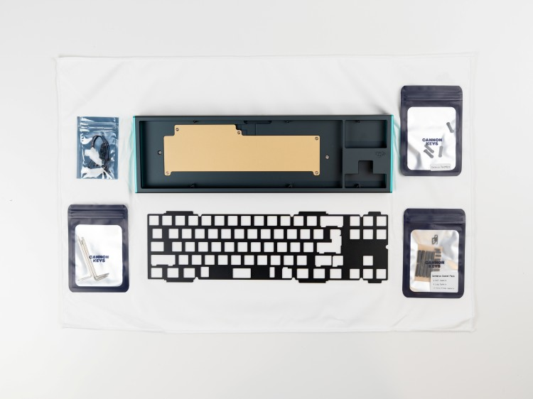

### Required Items (Not Included)

- USB cable
- Switches
- Stabilizers
- Keycaps

### Recommended Supplies

- Deskmat
- Metal tweezers
- Screw tray

## Testing the PCB

Before assembly, you must test functionality:

1. Locate the USB daughterboard and RGB daughterboard with their molex cables

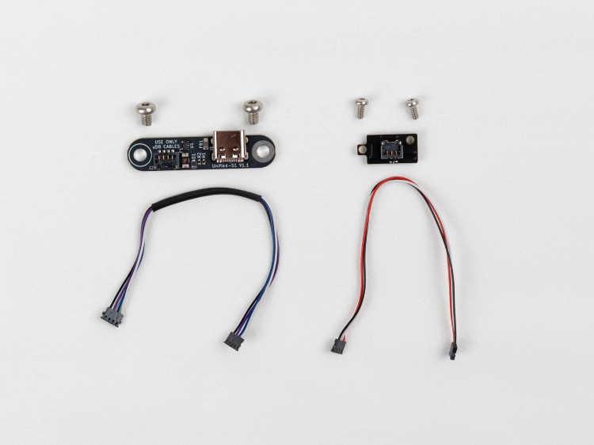

2. Connect the USB daughterboard to the PCB via the Molex cable

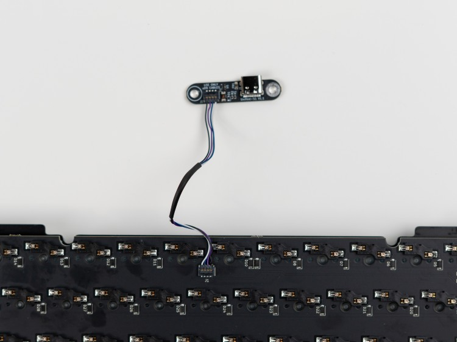

3. Plug into your PC and access the online VIA tool at [usevia.app](https://usevia.app)
4. Use the Keytester to verify each key responds correctly using metal conductors (tweezers)

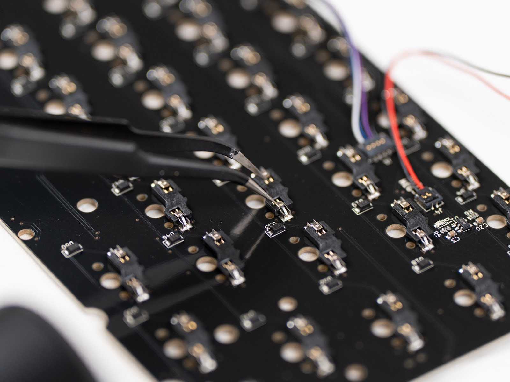

## Starting the Build

### Disassembly

1. Disassemble the pre-assembled case using T6/T8 Torx keys

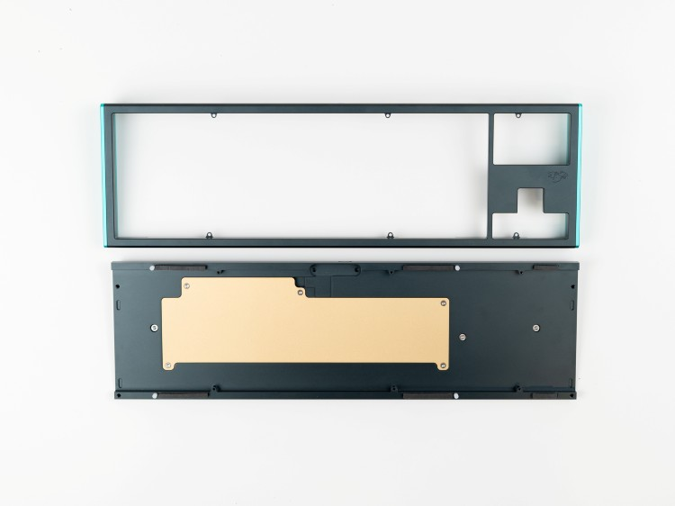

### Installing the Internal Weight

1. Install the internal weight with the specific countersunk screws provided

### Mounting the Daughterboard

1. Mount the USB daughterboard in its designated location

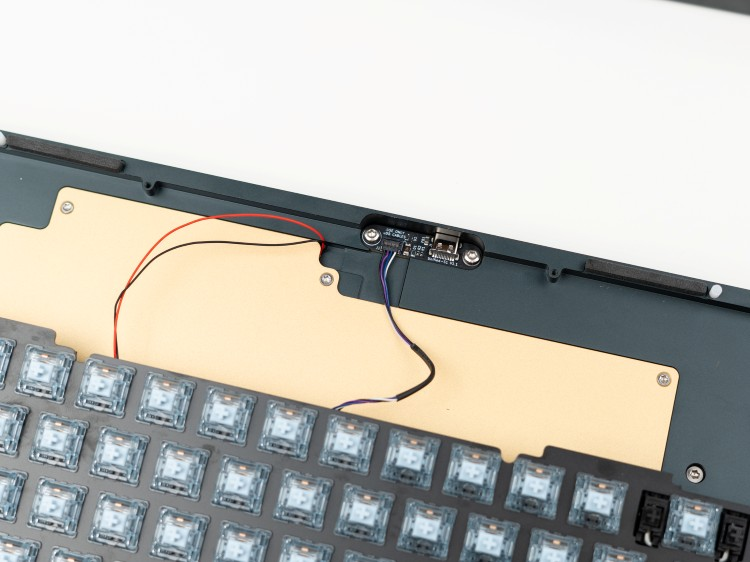

!!! note "Wireless Versions"
    For wireless versions, insert the battery before reinstalling the weight.

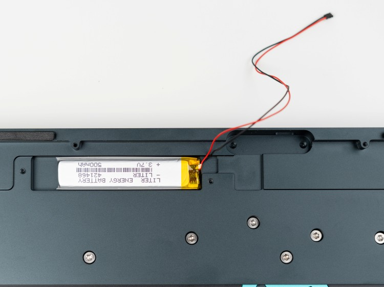

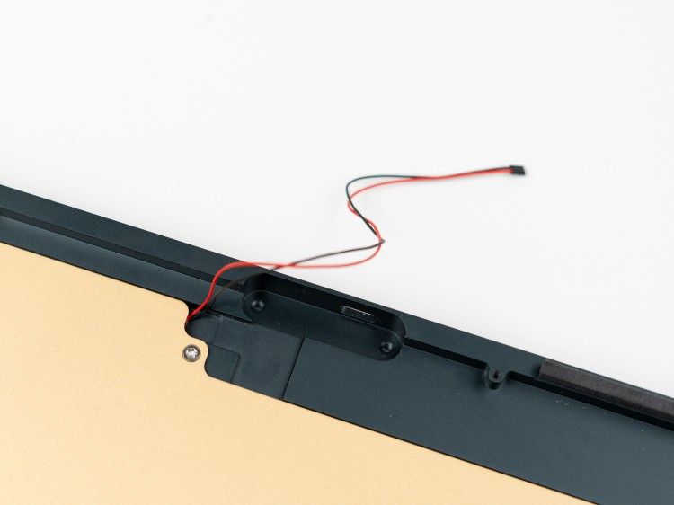

### Switches and Stabilizers

1. Install stabilizers on the PCB
2. Install switches into the PCB/plate assembly

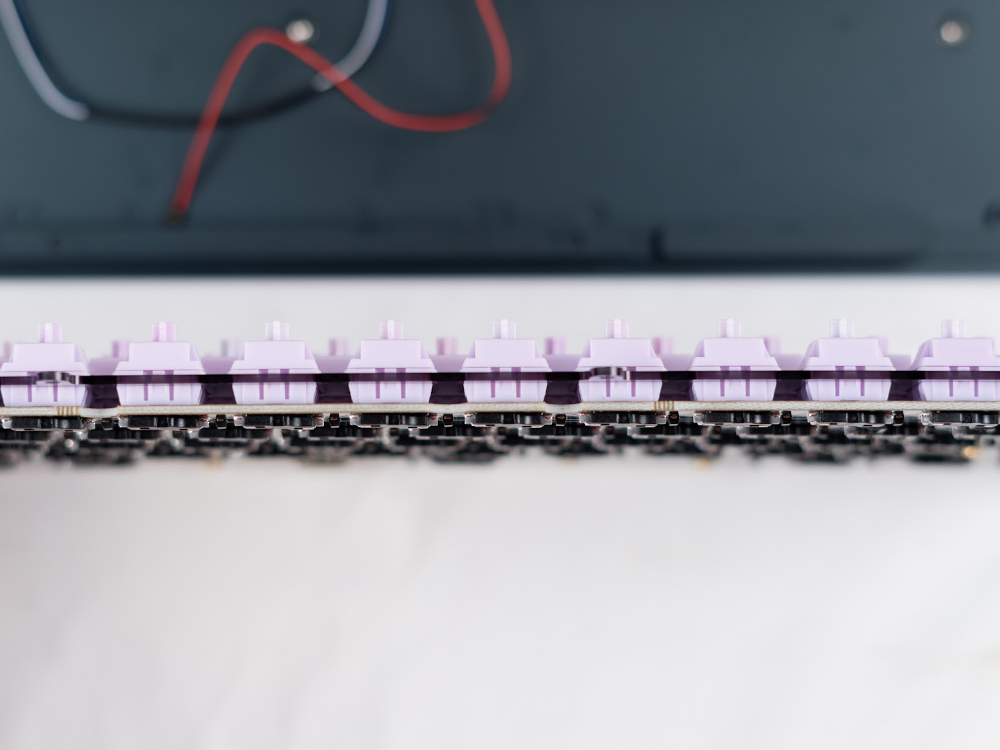

## Final Assembly

### Gasket Installation

1. Install plate gaskets in the designated grooves (shown in blue)

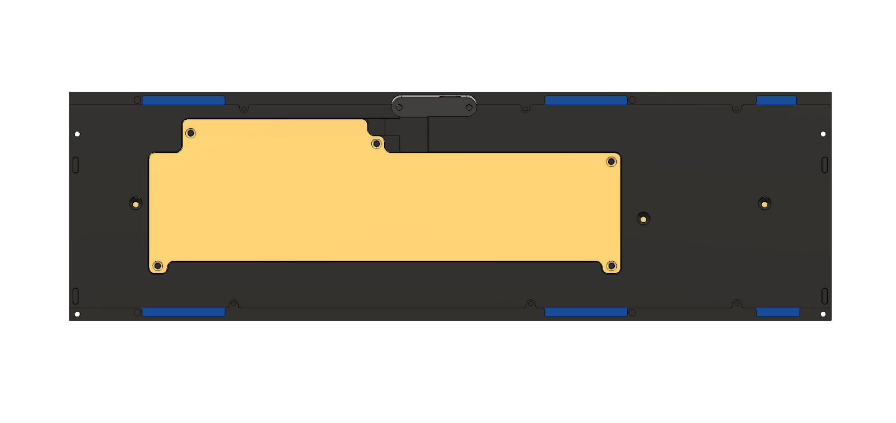

2. Place force break gaskets in the top case (shown in blue), along with side weights (shown in red)

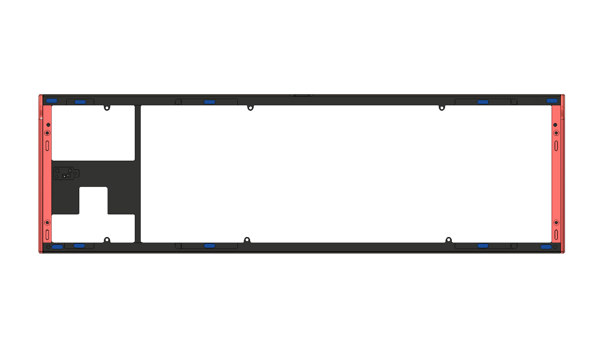

### RGB Daughterboard

1. Locate the RGB daughterboard mounting area in the top case

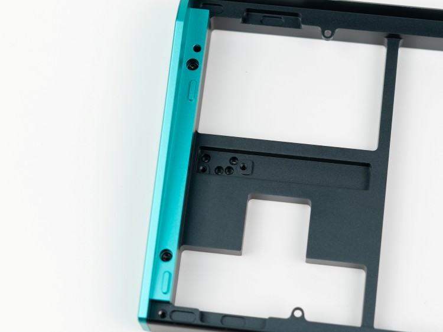

2. Install the RGB daughterboard with the Poron insulator

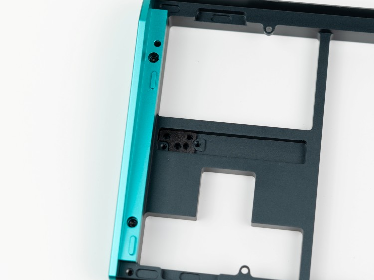

### Connecting Cables

1. Connect the RGB Molex cable from the PCB to the daughterboard in the top case - ensure proper orientation

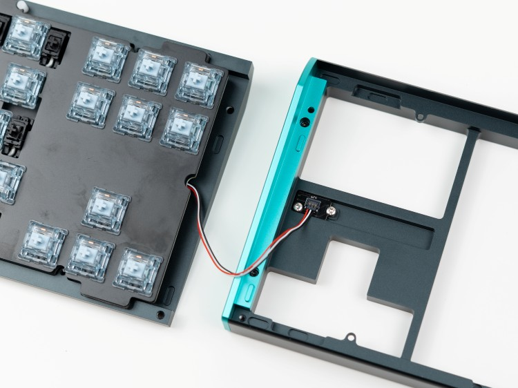

### Closing the Case

1. Align the assembly using the alignment pins
2. Secure the complete assembly
3. Fasten top and bottom cases together

!!! warning "Important"
    It is vital to not overtighten the keyboard. As soon as you start to feel resistance when screwing in, it's best to stop.

## Post-Build Configuration

### Wired Versions

Wired versions use QMK and VIA compatibility for custom key remapping.

1. Visit [usevia.app](https://usevia.app)
2. Connect your keyboard
3. Customize your keymap

### Wireless Versions

Wireless versions are compatible with ZMK Studio.

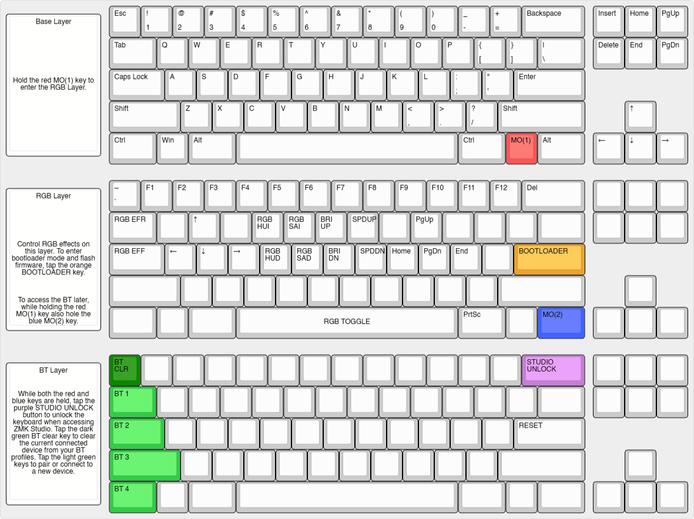

#### Bootloader Access

- Hold the red key, tap the orange key

#### ZMK Unlock

- Hold red and blue keys, tap purple key

#### Bluetooth Device Pairing

Use MO(1)+MO(2) combined with:

| Key | Device |
|-----|--------|
| Tab | Device 1 |
| Caps Lock | Device 2 |
| Shift | Device 3 |
| Ctrl | Device 4 |

Supports up to 4 paired devices.

#### Battery Toggle

The battery toggle switch is located near Caps Lock.

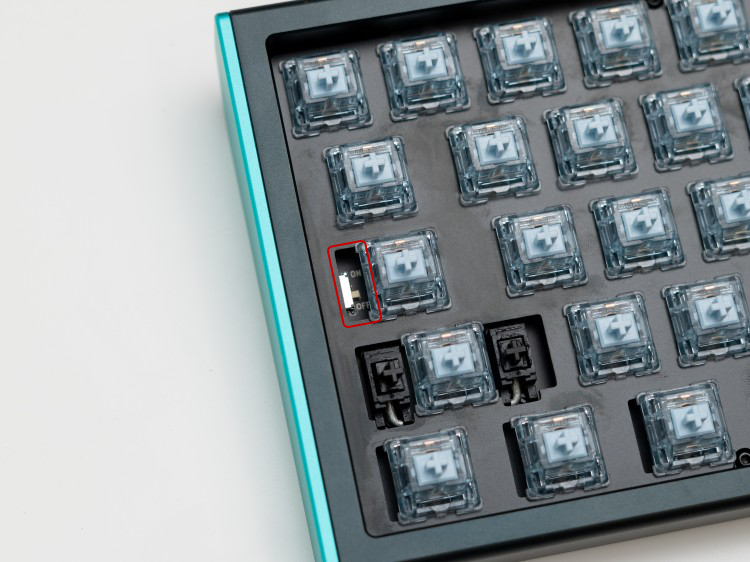

## Additional Resources

- Contact support via the website widget
- Community assistance available on the [CannonKeys Discord server](https://discord.gg/cannonkeys)
